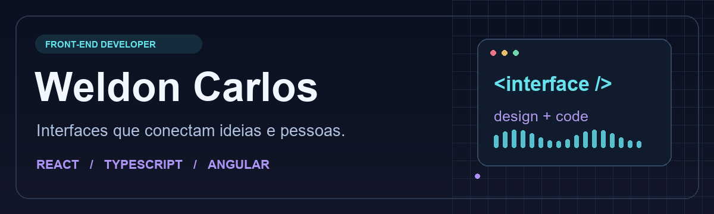
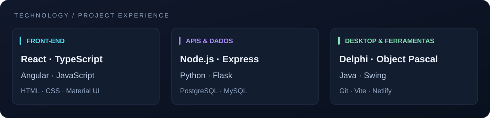

  

  <a href="#projetos-em-destaque">Projetos em destaque</a> ·
  <a href="#tecnologias">Tecnologias</a> ·
  <a href="#explore-meus-estudos">Estudos</a> ·
  <a href="https://www.linkedin.com/in/weldon-carlos-41b488231/">LinkedIn</a>

# Olá, eu sou Weldon Carlos 👋

Desenvolvedor front-end com foco em **React, TypeScript, JavaScript e interfaces responsivas**. Construo experiências web com atenção à organização dos componentes, integração com APIs e apresentação visual.

Meu portfólio reúne aplicações de catálogo, e-commerce, sites institucionais e ferramentas de geração de código. Também desenvolvo estudos de backend e aplicações desktop, ampliando minha visão sobre como uma interface se conecta aos dados e às regras de negócio.

<table>
<tr>
<td width="33%" valign="top"><strong>01 / INTERFACES</strong>  Componentes reutilizáveis, navegação, formulários e interfaces com React e Angular.</td>
<td width="33%" valign="top"><strong>02 / INTEGRAÇÕES</strong>  Consumo de APIs REST, estado da aplicação e persistência local no navegador.</td>
<td width="33%" valign="top"><strong>03 / APRENDIZADO</strong>  Projetos práticos com Node.js, Python, PHP, Java e Delphi.</td>
</tr>
</table>

## Tecnologias

| Área | Tecnologias utilizadas nos projetos | Exemplos |
| --- | --- | --- |
| Front-end | React, TypeScript, JavaScript, Angular, HTML e CSS | Game Explorer, Proway Computers, Retro Station |
| Interface e estado | Material UI, Bootstrap, Redux, React Router e localStorage | XBrain Store, Portfólio, Game Explorer |
| APIs e automação | Node.js, Express, Python, Flask, SQLAlchemy e Prisma | API Sistema de Pizzaria, API Generate |
| Desenvolvimento web com banco | PHP e MySQL | PetVida, CRUD PHP, PHP Academy |
| Desktop e dados | Delphi/Object Pascal, VCL, FireDAC e Java Swing | Agenda Delphi, Sistema de Clínica, BarberShop |
| Ferramentas | Git, GitHub, Vite, npm e Netlify | Organização do código, execução local e publicação |

## Projetos em destaque

<table>
<tr>
<td width="50%" valign="top">
<h3>🎮 Retro Station</h3>
Biblioteca de jogos retrô no navegador, com seleção de consoles, busca, capas e integração com EmulatorJS.  
<strong>JavaScript · HTML · CSS · Node.js</strong>  
<a href="https://retro-station.netlify.app/">Abrir aplicação ↗</a> · <a href="https://github.com/WeldonCarlos/retro-station">Código e documentação ↗</a>  
V1 acadêmica e experimental, construída com apoio do Codex.
</td>
<td width="50%" valign="top">
<h3>🕹️ Game Explorer</h3>
Catálogo conectado à RAWG, com busca, detalhes de jogos, paginação e favoritos salvos no navegador.  
<strong>React · TypeScript · Material UI · Axios</strong>  
<a href="https://levelgamelibary.netlify.app/">Abrir aplicação ↗</a> · <a href="https://github.com/WeldonCarlos/GAME-EXPLORER">Código e documentação ↗</a>
</td>
</tr>
<tr>
<td width="50%" valign="top">
<h3>⚙️ Gerador de APIs CRUD</h3>
Serviço que inspeciona uma tabela MySQL e gera uma API Flask em ZIP, acompanhado de uma interface por etapas.  
<strong>Python · Flask · MySQL · React · TypeScript</strong>  
<a href="https://github.com/WeldonCarlos/API_Generate">Backend ↗</a> · <a href="https://github.com/WeldonCarlos/Front_Generate_CRUD">Interface ↗</a>  
Protótipo para estudo de geração de código.
</td>
<td width="50%" valign="top">
<h3>🛒 Proway Computers</h3>
Demonstração de loja de informática com catálogo, pesquisa, descrição de produtos e carrinho local.  
<strong>Angular · TypeScript · RxJS · Material</strong>  
<a href="https://prowaycomputers.netlify.app/">Abrir aplicação ↗</a> · <a href="https://github.com/WeldonCarlos/proway-computers">Código e documentação ↗</a>
</td>
</tr>
<tr>
<td width="50%" valign="top">
<h3>🧾 XBrain Store</h3>
Experiência de compra demonstrativa, com produtos, carrinho em Redux e formulário de finalização.  
<strong>React · Redux · Material UI · Vite</strong>  
<a href="https://xbrain-store.netlify.app/">Abrir aplicação ↗</a> · <a href="https://github.com/WeldonCarlos/xbrain-store">Código e documentação ↗</a>
</td>
<td width="50%" valign="top">
<h3>🍕 API Sistema de Pizzaria</h3>
API REST para usuários, categorias, produtos e pedidos, com autenticação JWT e persistência em PostgreSQL.  
<strong>Node.js · TypeScript · Express · Prisma</strong>  
<a href="https://github.com/WeldonCarlos/API-Sistema-Pizzaria">Código e documentação ↗</a>
</td>
</tr>
</table>

## Explore meus estudos

- **Sites e apresentação:** [Portfólio](https://github.com/WeldonCarlos/Portifolio), [RN Concretagem](https://github.com/WeldonCarlos/rn-concretagem) e [Up Studio](https://github.com/WeldonCarlos/upstudio).
- **Interfaces e componentes:** [Painel de Controle de Tempo](https://github.com/WeldonCarlos/Painel-de-controle-de-tempo), [QR Code](https://github.com/WeldonCarlos/componente-de-codigo-QR) e [Landing Page Mario](https://github.com/WeldonCarlos/landingpage.mariobross).
- **PHP e persistência:** [PetVida](https://github.com/WeldonCarlos/PetVida), [CRUD PHP](https://github.com/WeldonCarlos/crud-php) e [PHP Academy](https://github.com/WeldonCarlos/PHP-ACADEMY).
- **Aplicações desktop:** [Agenda Delphi](https://github.com/WeldonCarlos/agenda_delphi), [Sistema de Clínica](https://github.com/WeldonCarlos/Sis_Clinica) e [BarberShop](https://github.com/WeldonCarlos/BarberShop).

Os READMEs descrevem o propósito, a execução e o estado de cada projeto. Exercícios, bases iniciais e protótipos estão identificados para facilitar a avaliação de quem visita.

## Vamos conversar

Tenho interesse em colaborar em projetos de front-end, interfaces e integração com APIs.

**[LinkedIn](https://www.linkedin.com/in/weldon-carlos-41b488231/)** · **[E-mail](mailto:weldonprogrammer2022@gmail.com)** · **[Todos os repositórios](https://github.com/WeldonCarlos?tab=repositories)**

---

Interfaces, integração e aprendizado contínuo — um projeto de cada vez.

